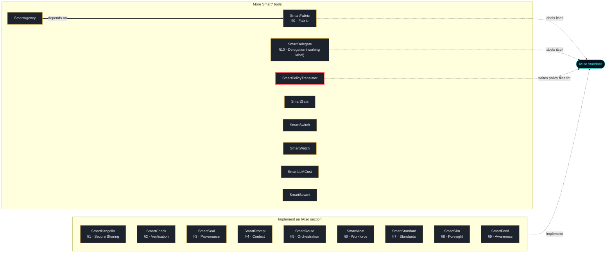

# SmartPolicyTranslator

**Translate natural-language regulation into REAL, schema-conformant [IAIso](https://github.com/SmartTasksOrg/IAIso) policy files — and wire them straight into your architecture.**

Regulation is prose. IAIso deployments run on *policy files*. SmartPolicyTranslator
closes that gap: it ingests regulatory text, parses each clause's deontic force
(MUST / SHOULD / MAY), and emits a valid **IAIso v1 policy document** — with full
provenance from every policy choice back to its source clause.

```
 ingest ─▶ parse (deontic) ─▶ translate ─▶ validate ─▶ audit
  text/PDF/URL   MUST/SHOULD/MAY   → IAIso policy   vs real schema   provenance
```

This is not an invented format. The IAIso policy schema, normative spec, and
official test vectors are vendored under `spec/iaiso/` directly from
[github.com/SmartTasksOrg/IAISO](https://github.com/SmartTasksOrg/IAISO)
(`IAIso-v5.0`). Every emitted policy is validated against them, and the loader
passes **all of IAIso's own policy test vectors**.

## Install

```bash
python -m pip install sf-smartpolicytranslator
sf-smartpolicytranslator --demo                  # translates a bundled sample regulation
sf-smartpolicytranslator regulation.txt          # your own: a text, PDF or DOCX file, a URL, or the text itself
```

The sample regulation is a short synthetic text written for the demo (the same as
`examples/sample_regulation.txt`), not a real law. `--demo` saves nothing.

Every file of `sf-smartpolicytranslator` on PyPI is built and published by this repository's release
workflow (`.github/workflows/release.yml`, PyPI trusted publishing) and carries a
provenance attestation that names this repository and that workflow; PyPI shows
it under "Verified details". The same workflow records a GitHub attestation for
the same files, which you can check with
`gh attestation verify <file> --repo SmartTasksOrg/sf-smartpolicytranslator`. A release file without
that provenance is not ours, and neither is a package called `smartpolicytranslator` (without
`sf-`) on any registry.

Version 1.0.0 (published 2026-10-09) is the first release under this name.

To install from a clone instead (Python 3.10 or later):

```bash
git clone https://github.com/SmartTasksOrg/sf-smartpolicytranslator
cd sf-smartpolicytranslator
python -m venv .venv
. .venv/bin/activate          # Windows PowerShell: .\.venv\Scripts\Activate.ps1
python -m pip install .
sf-smartpolicytranslator --demo
```

## Status

- **Version 1.1.0, experimental.** Translates regulation text into IAIso v1 policy files that are validated against the IAIso schema and test vectors vendored in `spec/iaiso/`; 10 tests. The `sf-smartpolicytranslator` command and `--demo` are in 1.1.0 and later; the 1.0.0 release did not have them.
- **Published:** PyPI `sf-smartpolicytranslator` (see Install). Nothing else is published. From a PyPI install the command line validates with the built-in validator; the JSON-Schema check, `run_vectors()` and the API's `/iaiso/schema` read `spec/iaiso/`, which is not in the wheel yet, so they need a clone.
- **Tested:** the 10 tests in `tests/` on Python 3.12, Linux, on every push to main and every pull request (`.github/workflows/ci.yml`).
- **Not tested:** Windows and macOS; the LLM-assisted parsing path; Python versions other than 3.12.
- **Ports:** The client ports in `ports/` have no automated check; none is published on a registry.
- **Security review:** none independent. Report vulnerabilities as described in [SECURITY.md](SECURITY.md).

## Ready to run

The core needs **zero third-party packages** (stdlib only):

```bash
export PYTHONPATH=src
python3 -m sf_smartpolicytranslator.cli examples/sample_regulation.txt
# → a valid IAIso policy: version "1", enforcement_mode, consent scopes, pressure…

# LLM-assisted parsing (LM Studio / Ollama / llama.cpp):
python3 -m sf_smartpolicytranslator.cli --llm --provider lmstudio examples/sample_regulation.txt

# REST service:
bash scripts/run.sh          # → http://localhost:8000/docs   (or: docker build/run)
```

## What the translation produces

A regulation with MUST/high-risk obligations yields a **strict, fail-closed** IAIso
policy: `enforcement_mode: "strict"`, `consent.required_scopes` derived from the
data/access obligations (in IAIso's scope grammar, e.g. `data.pii.read`,
`model.invoke`, `decision.override`), a tightened `pressure` posture
(`escalation_threshold` lowered, `post_release_lock` on), a shorter consent TTL,
and a `metadata.provenance[]` trail mapping each choice to its clause. A permissive
regulation yields a permissive policy.

## Integrations & ports

SmartPolicyTranslator **produces** IAIso policy; IAIso **enforces** it.

- **LangChain (+ real IAIso SDK)** — `integrations/langchain/`:
  `bounded_execution_from_regulation()` translates regulation and loads the policy
  into IAIso's real `BoundedExecution` + `IAIsoCallbackHandler`, so a LangChain LLM
  is governed by the translated policy (`pip install iaiso[langchain]`).
- **n8n / Flowise** — `integrations/n8n/`, `integrations/flowise/`.
- **Language ports** — `ports/{node,react,java,go,php,ruby,rust,csharp,swift,c,cpp}`,
  mirroring every language IAIso itself ships (plus React and C/C++) so a policy can
  be generated and enforced in the language of your IAIso deployment. See
  `ports/README.md` for the port↔`iaiso-*` map.
- **Local LLMs** — `src/sf_smartpolicytranslator/llm.py`: one OpenAI-compatible client
  for LM Studio, Ollama, and llama.cpp.

## Tests

```bash
python3 -m pytest tests/ -q     # translation + REAL IAIso schema/vector conformance
```

These run on the standard library alone — no `iaiso` package or network required.


## Part of the Smart* family

<!-- smart-family:start -->
<!-- generated by fleet-docs from family.json; change family.json, not this block -->

18 open-source tools by SmartTasks Lab, each standalone, plus the [IAIso standard](https://github.com/SmartTasksOrg/IAISO). Every tool is on PyPI under its `sf-` name; a package without the `sf-` prefix is not ours.

| Tool | IAIso | What it does |
|---|---|---|
| [SmartPangolin](https://github.com/SmartTasksOrg/sf-smartpangolin) | §1 · Secure Sharing | Scan before you share. Stop leaking secrets into AI models, agents, and tools. |
| [SmartCheck](https://github.com/SmartTasksOrg/sf-smartcheck) | §2 · Verification | Check before you sign off. Catch the AI when it's confidently wrong. |
| [SmartSeal](https://github.com/SmartTasksOrg/sf-smartseal) | §3 · Provenance | Seal what you ship. A signed receipt so anyone can verify what they received. |
| [SmartPrompt](https://github.com/SmartTasksOrg/sf-smartprompt) | §4 · Context | Lint before you send. Bad prompt in, bad work out — and it's your name on it. |
| [SmartRoute](https://github.com/SmartTasksOrg/sf-smartroute) | §5 · Orchestration | Route only what you trust. Gate agents and tools with trust scores and guardrails. |
| [SmartMoat](https://github.com/SmartTasksOrg/sf-smartmoat) | §6 · Workforce | Know your moat. Score the tasks AI can't easily take — and widen them. |
| [SmartStandard](https://github.com/SmartTasksOrg/sf-smartstandard) | §7 · Standards | Standardize before you scale. One shared, auditable convention for AI-assisted work. |
| [SmartSim](https://github.com/SmartTasksOrg/sf-smartsim) | §8 · Foresight | Simulate before it hits you. See your role's task-by-task collapse sequence. |
| [SmartFeed](https://github.com/SmartTasksOrg/sf-smartfeed) | §9 · Awareness | Distill the firehose. A tight brief of only what moves your work. |
| [SmartFabric](https://github.com/SmartTasksOrg/sf-smartfabric) | §0 · Fabric | IAIso Fabric Protocol (IFP) — carry & enforce IAIso containment across a fleet of governed AI nodes. |
| [SmartDelegate](https://github.com/SmartTasksOrg/sf-smartdelegate) | §10 · Delegation (working label) | Delegate, don't hand over the keys. An agent never holds more than the human's role for the task: IAM for LLM agents. |
| **[SmartPolicyTranslator](https://github.com/SmartTasksOrg/sf-smartpolicytranslator)** (this repository) | writes IAIso policy files | Translate natural-language regulation into REAL, schema-conformant IAIso policy files. |
| [SmartAgency](https://github.com/SmartTasksOrg/sf-smartagency) | — | Signed contracts that say what an AI agent may do, a ledger to suspend and revoke them, and a monitor that enforces them on every action, with SmartFabric pressure limits. |
| [SmartGate](https://github.com/SmartTasksOrg/sf-smartgate) | — | Decision friction and a human override for AI agents: score each action, ask a person before risky ones, kill any action or agent with one logged call. |
| [SmartSwitch](https://github.com/SmartTasksOrg/sf-smartswitch) | — | A quorum kill switch for AI agent fleets: no single keyholder can halt the fleet or block a halt; every agent verifies the signatures itself and stops when cut off. |
| [SmartWatch](https://github.com/SmartTasksOrg/sf-smartwatch) | — | Coupling-density monitor for multi-agent systems: measures how densely agents talk to each other, raises graded alerts, and proposes or issues resets before coordination outgrows human oversight. |
| [SmartLLMCost](https://github.com/SmartTasksOrg/sf-smartllmcost) | — | Apples-to-apples LLM cost & performance benchmark — cost per successful task, reproducible. |
| [SmartSavant](https://github.com/SmartTasksOrg/sf-smartsavant) | — | A model-agnostic design council: stakeholder views and a juror merge per design-sprint phase, schema-checked adapter answers, exports (spec, stories, decision tree, trainset) and audits of council runs before anyone builds or trains from them. |



Thick arrow: the package requires the other one in its `pyproject.toml`. Dashed arrow: what the tool's README states about IAIso. A tool with no thick arrow does not depend on any other family package; each one installs and runs on its own.

<!-- smart-family:end -->

## Who's behind this

- **Roen Branham** — CEO & AI Strategy Architect · CISSP-certified AI, security & governance architect; author of IAIso and sole inventor of the Z4 Semantic Fabric patent application. [LinkedIn](https://www.linkedin.com/in/roen-branham-167ab29/)
- **Le Vu Tanh** — CTO & Core Engineering Lead · Chief architect of the Cortex engine; large-scale system reliability and low-latency infrastructure — the engineer who ships what gets architected. [LinkedIn](https://www.linkedin.com/in/lee-thanh-76aa8ba0/)

The team behind IAIso & SmartTasks: a CISSP-certified security & governance architect
and a large-scale systems engineer — 20+ years shipping secure, AI-driven platforms for
regulated, blue-chip environments (Allianz, BMW, Rolls-Royce, Heidenhain).

<!-- SMARTTASKS-MODELS:START -->
## Runs on governed local models

Structured, machine-readable **scorecards** make model choice precise instead of guesswork.

This tool is local-first, so pair it with models you can actually vet. **SmartTasks** publishes 21+ governance-validated GGUF builds on Hugging Face — each with a machine-readable **scorecard** (capability tiers L1 Layman → L5 Agentic, IAIso conformance invariants (pass/warn/fail), OWASP-mapped garak red-team, transparency probes (viewpoint-alignment / over-refusal), and per-file SHA-256). Gate model selection on evidence, not vibes — and every finding, including warnings, is published in full.

→ **[SmartTasks on Hugging Face](https://huggingface.co/smarttasks)** · [Qwen3.6-27B](https://huggingface.co/smarttasks/Qwen3.6-27B-GGUF) (L5 agentic) · [react-agent-coder-llama-3.1-8b](https://huggingface.co/smarttasks/react-agent-coder-llama-3.1-8b-GGUF) (agentic coder) · [gpt-oss-20b](https://huggingface.co/smarttasks/gpt-oss-20b-GGUF) (open reasoning)
<!-- SMARTTASKS-MODELS:END -->

## Get in touch

- **Companies & enterprises:** [enterprise@smarttasks.cloud](mailto:enterprise@smarttasks.cloud) — we help
  teams integrate SmartPrompt + IAIso into their architecture so governance and
  audit-readiness become a byproduct of how they already work.
- **The standard:** [IAIso](https://github.com/SmartTasksOrg/IAIso) · [iaiso.org](https://iaiso.org)
- **The product:** [SmartTasks.cloud](https://smarttasks.cloud)

Built by **SmartTasks Lab**. Apache-2.0. Contributions welcome.
